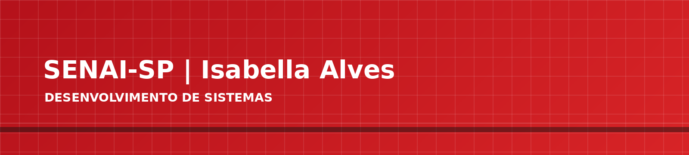
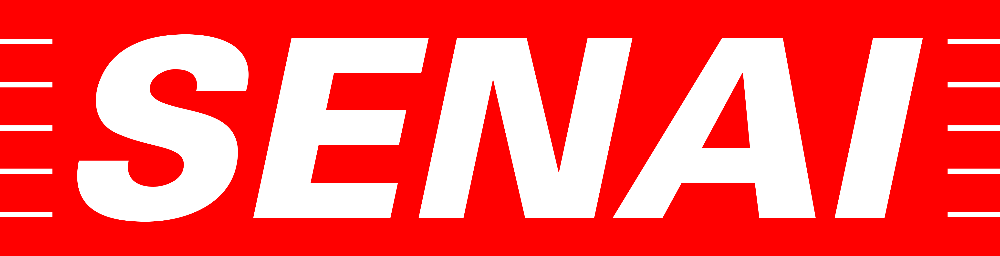
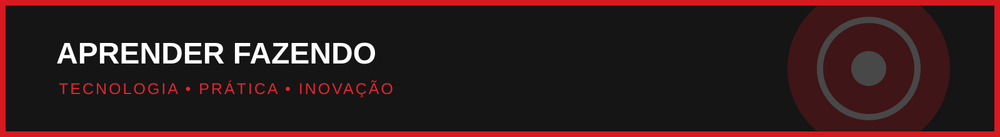
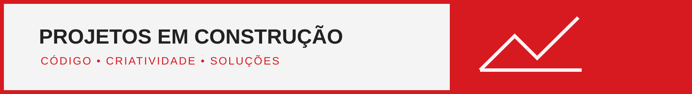

  

  

# SENAI-SP | Isabella Alves

### Estudante de Desenvolvimento de Sistemas | SENAI-SP

---

## Sobre mim

Sou estudante do curso de **Desenvolvimento de Sistemas na Escola SENAI Luiz Varga**. Tenho interesse por programação, desenvolvimento web e criação de soluções, e venho construindo minha experiência por meio de atividades práticas e projetos acadêmicos.

  

## Tecnologias e assuntos em estudo

  
  
  
  
  

Também estou praticando **lógica de programação**, **modelagem de bancos de dados relacionais**, estruturas de repetição, arrays e fundamentos de desenvolvimento backend.

  

## Projetos e práticas acadêmicas

- **Python:** exercícios e materiais de estudo relacionados às aulas do primeiro termo.
- **Desenvolvimento web:** páginas e atividades com HTML e CSS, além de projetos acadêmicos com funcionalidades de um sistema de delivery.
- **JavaScript e Node.js:** exercícios de lógica e backend, incluindo arrays, laços, funções e entrada de dados pelo terminal.
- **Tecnologia aplicada à indústria:** práticas com exemplos de produção, materiais, ciclos, medições e controle de dados.
- **Banco de dados:** introdução à modelagem conceitual de dados relacionais.

## Objetivo

Continuar aprendendo e desenvolvendo projetos que unam programação, criatividade e resolução de problemas. Este perfil acompanha minha jornada no curso de Desenvolvimento de Sistemas.

---

  

**SENAI-SP · Aprender fazendo**

